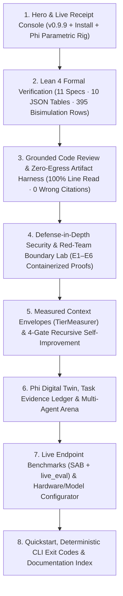

# `selfware.design` Redesign Guidelines — From AI Slop to Evidence-Backed Systems Engineering

**Status:** Canonical Redesign Specification for `https://selfware.design`  
**Target Release:** `selfware v0.9.9`  
**Governing Principles:** [`AGENTS.md`](../AGENTS.md) Rule 1 (Stop-the-line), Rule 3 (Honest status over optimistic success), Rule 4 (Measured, not estimated), Rule 5 (Sweep the bug class)

---

## 1. Executive Diagnosis: Why the Current `selfware.design` Reads as "Claude 4.8 Slop"

An audit of the live `https://selfware.design` document (`1,879` lines of HTML/CSS/JS across `22` `<section>` blocks) reveals two classes of defects: **visual/copywriting AI-landing-page tropes** and **direct factual contradictions of the `selfware` codebase**.

### 1.1 Visual & Copywriting "AI Slop" Anti-Patterns on the Current Site

| Slop Pattern on Live Site | Where It Appears | Why It Hurts Credibility |
|---|---|---|
| **Editorial Serif + Gold-on-Olive Cliché** | Global CSS (`Instrument Serif` + `Newsreader` italic `clamp(52px, 8vw, 100px)` headers over `#0c0f08` olive-black and `#D4A373` gold gradients) | Looks identical to thousands of one-shot LLM-generated "luxury AI startup" templates instead of a rigorous Rust systems tool. |
| **Fabricated Anonymous Testimonials** | Section 17 (`EARLY ADOPTERS`: `"S — Systems engineer, Game server team"`, `"M — ML researcher, University lab"`, `"S — Staff engineer, Enterprise software team"`) | Single-letter anonymous quotes with generic praise (`"Watching it improve its own code is wild"`) are an instant tell of LLM-hallucinated social proof. |
| **Pseudo-Scientific Filler Widgets** | Section 8 (`WOLFRAM'S FOUR CLASSES`: `— Flat`, `∿ Repetitive`, `⚡ Chaotic`, `✦ Complex` buttons) & Section 21 (`AT THE EDGE OF CHAOS`: Conway's Game of Life canvas) | Neither Wolfram's cellular automata classes nor Conway's Game of Life exist in `src/`. Including toy JS canvases pretending to explain agent architecture insults systems engineers. |
| **`setTimeout`-Animated Fake Telemetry** | Section 10 (`#vision-loop-terminal`: hardcoded `iterScores=[{comp:45,hier:52,read:71},{comp:68,hier:70,read:80},{comp:82,hier:78,read:91}]` animating to green on scroll) | Violates [`AGENTS.md`](../AGENTS.md) Rule 3 (*"Never render green for checks that were not performed"*). Scripting a fake progress bar from 45% to 91% is theatre, not engineering. |
| **Generic Emoji Cards Instead of Shipped Vector Craft** | Section 5 & 13 (`🏗️ Architect`, `💻 Coder`, `🧪 Tester`, `🔍 Reviewer`, `🌊`, `🧬`, `🔄`, `🌱`) | Selfware has a mathematically defined parametric mascot (`Phi` in [`design/mascot/README.md`](../design/mascot/README.md) and [`src/evolve/web/phi/phi_fox.js`](../src/evolve/web/phi/phi_fox.js)), yet the website uses stock Unicode emojis. |
| **Bloated 22-Section Scroll Marathon** | 22 `<section data-fade>` blocks with repetitive `linear-gradient(180deg, transparent, rgba(212,163,115,0.03), transparent)` dividers | Dilutes the real differentiators (Lean 4 formal proofs, line-verified citations, zero-egress `artifact-harness`, Boundary Lab `E1–E6`) under repetitive slogans (`"Intelligence should be owned, not rented"` repeated 4 times). |

### 1.2 Factual Inaccuracies & Stale Metadata on the Current Site

1. **Stale Version (`v0.9.7` vs `v0.9.9`)**:
   - The hero badge and JSON-LD `<script type="application/ld+json">` report `"softwareVersion": "0.9.7"`.
2. **False Claim: *"No formal verification"* (Section 12, `KNOWN LIMITATIONS`, `L1092`)**:
   - The live site states: `"• No formal verification of generated code — tests are the safety net"` (while contradicting itself 27 lines later at `L1119` with a `"Proved in Lean"` card).
   - **Codebase Truth (`v0.9.9`)**: Selfware ships **11 Lean 4 specification files** (`formal/*.lean`, **14,655 lines of Lean 4**, **670 machine-checked theorems**, `0` `sorry`/`admit`/`axiom`), **10 exported JSON decision tables** (`formal/*.json`, **1,056 total rows**), including **395 rows (`PA1–PA78`)** in [`formal/phi_arena_trust_table.json`](../formal/phi_arena_trust_table.json) and **56 rows (`BH1–BH5`, `PT1–PT5`)** in [`formal/harness_twin_table.json`](../formal/harness_twin_table.json), verified against [`src/phi/policy_tests.rs`](../src/phi/policy_tests.rs) (`17,443` lines) via [`scripts/check_formal.sh`](../scripts/check_formal.sh).
3. **False Claim: *"Safety boundaries are advisory when autonomy level is set to maximum"* (Section 12)**:
   - **Codebase Truth (`v0.9.9`)**: `--mode yolo` skips interactive confirmation prompts for allowed operations; it **never** disables `DENIED_PATHS` descriptor checks, `PROTECTED_PATHS` evolution guards, git config quarantine (`-c core.fsmonitor=false -c core.hooksPath=/dev/null`), environment credential scrubbing, or SSRF IPv4-mapped IPv6 blocking.
4. **Fabricated Evolution Fitness Weights (Section 9)**:
   - The live site displays a static bar: `SAB Score 50% | Token Efficiency 25% | Latency 15% | Coverage 5% | Binary Size 5%`.
   - **Codebase Truth (`v0.9.9`)**: `selfware evolve` uses [`SelfEditOrchestrator`](../src/evolve/orchestrator.rs) and [`GroundedAssistant`](../src/evolve/assistant.rs) with a strict 4-gate contract (`cargo check`, `cargo test --lib`, `git diff` protected-path enforcement, and grounded line-cited review with `trust_state: structural | partial | ungrounded`) plus measured context-fit envelopes ([`TierMeasurer`](../src/evolve/context_fit.rs) across `Full`, `Compact`, `Lite`, `Map`).
5. **Contradictory Privacy Banner (Section 1 vs Section 2)**:
   - Section 2 badges say `✓ No API keys | ✓ No telemetry | ✓ No cloud dependency`, while Section 1 says `"Try it runs in a 15-min sandboxed container on our server, currently backed by DeepSeek V4 Flash via OpenRouter"`. The distinction between the **zero-egress local CLI binary** and the **optional hosted web sandbox** must be stated with architectural precision, not contradictory marketing badges.

---

## 2. Design Constitution: Four Non-Negotiable Rules for `selfware.design`

Every line of copy, CSS rule, and interactive component on `selfware.design` must obey these four rules:

### Rule 1 — Every Number Must Have a Repo Path or Receipt
Never put a metric on the page unless it links to the exact source file, test binary, or benchmark report that produces it:
- **395 formal bisimulation rows (`PA1–PA78`, `PT1–PT5`)** → link to [`formal/PhiArenaAndTrustBounds.lean`](../formal/PhiArenaAndTrustBounds.lean), [`formal/phi_arena_trust_table.json`](../formal/phi_arena_trust_table.json), and [`src/phi/policy_tests.rs`](../src/phi/policy_tests.rs).
- **11 Lean 4 formal models & 10 decision tables** → link to [`formal/`](../formal/) and [`scripts/check_formal.sh`](../scripts/check_formal.sh).
- **6 Red-Team Boundary Lab scenarios (`E1–E6`)** → link to [`docs/redteam_boundary_lab.md`](../docs/redteam_boundary_lab.md) and [`scripts/boundary_lab/`](../scripts/boundary_lab/).
- **100% line coverage in parallel sharded review with 0 wrong citations** → link to [`src/agent/citation_check.rs`](../src/agent/citation_check.rs) and [`src/review.rs`](../src/review.rs).
- **19.8× live `c24` speedup (`21.2s`, `10,879` tokens, `done_check = true`)** → link to [`scripts/live_eval/`](../scripts/live_eval/) and [`docs/live-eval.md`](../docs/live-eval.md).

### Rule 2 — Zero Fake Interactive Theatre
- **Forbidden**: `setTimeout` loops that animate fake terminal lines or fake score bars from red to green; Conway's Game of Life; Wolfram cellular automata toggles; fake newsletter forms (`"✓ Subscribed! Stored locally on this server"`).
- **Required**: Interactive components must inspect **real artifacts**:
  1. **Interactive Lean ↔ Rust Decision Table Inspector**: Renders real rows from [`formal/phi_arena_trust_table.json`](../formal/phi_arena_trust_table.json) (`PA1–PA78`), letting the visitor filter by invariant class (Trust Gate, Citation Grounding, Compaction Budget, Arena Winner, RSI Promotion) and see the exact Lean theorem + Rust assertion.
  2. **Interactive Hardware & Model Profile Calculator**: Selects GPU/Mac RAM (`16 GB` to `2× RTX 4090` / `RTX 6000 Pro` / `Mac 128 GB`) and outputs the **exact measured `selfware.toml` + `sglang`/`vllm`/`llama-server` command** from [`docs/serving-sglang.md`](../docs/serving-sglang.md) and [`src/config/model_profiles.rs`](../src/config/model_profiles.rs).
  3. **Deterministic `Phi` Mascot Inspector**: Uses the real [`design/mascot/mascot.js`](../design/mascot/mascot.js) / [`src/evolve/web/phi/phi_fox.js`](../src/evolve/web/phi/phi_fox.js) parametric SVG generator (`SelfwareMascot.svg({ ears, curl, softness, mood, construction })`) with a toggle to show the underlying mathematical construction lines (superellipse body, Gaussian ears, golden-spiral tail) and real `PhiEvent` receipt states (`greeting`, `thinking`, `working`, `success`, `guard`, `evolve`).

### Rule 3 — Honest Status Over Optimistic Success
- Show Selfware's **honest status badges** as first-class UI elements on the website:
  - `✅ VERIFIED` — `cargo check` / `cargo test` ran on the final tree and passed; citations matched exact quoted lines.
  - `ℹ️ LOCATION-ONLY` — `path:line` exists in workspace, no inline quote attached.
  - `⚠️ PARTIAL` — Budget/wall-clock reserve triggered or verification check was not performed (`verification NOT PERFORMED`).
  - `⚠️ PRE-EXISTING` — Test failure existed on the baseline snapshot before the agent edited any file.
  - `✗ BLOCKED` — Stopped by `DENIED_PATHS`, `PROTECTED_PATHS`, untrusted repo gate (exit `5`), or headless confirmation gate (exit `6`).
- Explain **why** a developer trusts a tool that reports `⚠️ PARTIAL (read 48 of 60 files)` infinitely more than a tool that lies with `✅ Done` after reading 3 files.

### Rule 4 — Industrial Datasheet Aesthetic, Not "AI Marketing" Aesthetic
- Design inspiration: **Oxide Computer, TigerBeetle, SQLite, Linear engineering specs, and [`design/mascot/`](../design/mascot/index.html)** — exposed structural grid hairlines, high-density monospace tables, deterministic SVG geometry, zero fluff.

---

## 3. Visual System, Typography & Color Architecture

### 3.1 Typography (Drop `Instrument Serif` & `Newsreader`)

The current combination of `Instrument Serif` + `Newsreader` italics screams "2025 Claude artifact landing page." Replace it with a two-family technical stack:

```css
:root {
  /* Primary UI & Structural Headings: crisp geometric sans */
  --font-sans: "Inter", -apple-system, BlinkMacSystemFont, "Segoe UI", Roboto, sans-serif;

  /* Code, Proofs, Tables, Badges, & Metrics: tabular monospace */
  --font-mono: "JetBrains Mono", "Berkeley Mono", "IBM Plex Mono", "SFMono-Regular", Consolas, monospace;
}

/* Type Scale — Compact, high-density, zero oversized 100px serif posters */
.h-hero {
  font-family: var(--font-sans);
  font-size: clamp(2.25rem, 4.2vw, 3.5rem);
  font-weight: 650;
  line-height: 1.08;
  letter-spacing: -0.03em;
}

.h-section {
  font-family: var(--font-sans);
  font-size: clamp(1.5rem, 2.5vw, 2.125rem);
  font-weight: 600;
  line-height: 1.15;
  letter-spacing: -0.02em;
}

.mono-metric, td, th, .badge {
  font-family: var(--font-mono);
  font-variant-numeric: tabular-nums;
}
```

- **Never use italic serif words inside headings** (e.g., delete `<em>your</em>`, `<em>no one</em>`, `<em>emerge</em>`, `<em>see.</em>`).
- **Keep body copy between `60ch` and `72ch`** with `line-height: 1.6` and `#c9d1d9` on `#0b0d10` (WCAG AAA contrast `> 11:1`, replacing the low-contrast `#7a7567` / `#8a8272` muted olive grays on the current site).

### 3.2 Color Tokens (Workshop Obsidian + Amber Signal + Semantic Receipt States)

Replace the murky olive-green (`#0c0f08`) and washed-out tan (`#D4A373`) with crisp obsidian slate surfaces, exposed `1px` structural borders, and the exact Amber/Copper tokens used by `Phi` ([`src/evolve/web/phi/phi_fox.js`](../src/evolve/web/phi/phi_fox.js)):

```css
:root {
  /* Surfaces */
  --bg-canvas:      #0a0c0e;   /* Deep carbon slate */
  --bg-panel:       #101418;   /* Elevated card / terminal surface */
  --bg-panel-alt:   #151a1f;   /* Table header / code gutter */
  --border-hairline:#212830;   /* Exposed 1px structural grid line */
  --border-focus:   #d97706;   /* Amber active border */

  /* Typography */
  --text-primary:   #f0f4f8;   /* Crisp off-white (contrast 16.5:1) */
  --text-secondary: #9fb0c0;   /* Technical prose (contrast 8.4:1) */
  --text-muted:     #6e7f91;   /* Captions, line numbers (contrast 4.7:1) */

  /* Brand & Mascot (Phi Mathematical Palette) */
  --phi-amber:      #e07a24;   /* Primary brand accent & Phi coat */
  --phi-copper:     #b85618;   /* Secondary structural accent */
  --phi-cream:      #f6ede2;   /* High-emphasis callout */
  --phi-gold:       #f59e0b;   /* Golden-ratio spiral / Lean proof highlight */

  /* Honest Status Badges (AGENTS.md Rule 3) */
  --status-verified-bg: rgba(46, 160, 67, 0.14);
  --status-verified-fg: #3fb950;
  --status-partial-bg:  rgba(210, 153, 34, 0.14);
  --status-partial-fg:  #d29922;
  --status-blocked-bg:  rgba(248, 81, 73, 0.14);
  --status-blocked-fg:  #f85149;
  --status-info-bg:     rgba(56, 139, 253, 0.14);
  --status-info-fg:     #58a6ff;
}
```

### 3.3 Layout & Structural Grid
- **Exposed Blueprint Grid**: Use a `max-width: 1200px` container with visible `1px solid var(--border-hairline)` cell boundaries (inspired by technical datasheets and IC pinout manuals) instead of floating cards swimming in blurry radial gradients.
- **Delete**:
  - Floating background `<canvas id="particles">`
  - Scroll-jacking fade-ins (`[data-fade]` starting at `opacity: 0; transform: translateY(28px)`) — content should be immediately visible and scannable without waiting for `IntersectionObserver`.
  - Right-hand floating `.nav-dots` and bottom-right `.sticky-cta` popups.
- **Keep & Upgrade**:
  - A single sticky top navigation bar (`height: 52px`, `border-bottom: 1px solid var(--border-hairline)`) with:
    `[Phi Icon] selfware v0.9.9` · `Proofs (Lean 4)` · `Grounded Review` · `Boundary Lab` · `Evolve & Context` · `Benchmarks` · `Hardware Fit` · `[GitHub ↗]` · `[Crates.io ↗]`

---

## 4. Information Architecture: Replacing 22 Slop Sections with 8 High-Density Sections

### What to Delete Immediately from `selfware.design`

| Current Section | Verdict | Reason |
|---|---|---|
| **Section 2 (`WHAT WE BELIEVE`) & Section 3 (`WHY LOCAL-FIRST`)** | **CONSOLIDATE** into Hero sub-header | Repeating `"Intelligence should be owned, not rented"` across two full-viewport sections wastes vertical space before showing any technical proof. |
| **Section 8 (`WOLFRAM'S FOUR CLASSES`)** | **DELETE** | Pure LLM pseudo-science filler. Has zero connection to the codebase. |
| **Section 9 (`COMPOSITE FITNESS FUNCTION` 50/25/15/5/5 bar)** | **REPLACE** | Replace with the actual 4-gate `SelfEditOrchestrator` + `GroundedAssistant` + `TierMeasurer` pipeline. |
| **Section 10 (`#vision-loop-terminal` fake score animation)** | **DELETE** | Fake `setTimeout` score bars violate [`AGENTS.md`](../AGENTS.md) Rule 3. |
| **Section 12 (`KNOWN LIMITATIONS` saying *"No formal verification"* & *"advisory safety"*)** | **REPLACE** | Directly false in `v0.9.9`. Replace with the accurate [`docs/limitations.md`](../docs/limitations.md) contract and Boundary Lab `E1–E6` receipts. |
| **Section 17 (`EARLY ADOPTERS` anonymous `"S"`, `"M"`, `"S"` quotes)** | **DELETE** | Never use unattributed single-letter quotes. Let reproducible benchmarks, Lean proofs, and git commits speak for themselves. |
| **Section 21 (`AT THE EDGE OF CHAOS` — Conway's Game of Life)** | **DELETE** | Textbook AI-generated filler widget. |
| **Section 22 (`Join the inner loop` fake email capture)** | **DELETE** | Replace with direct links to GitHub Releases RSS, GitHub Discussions, and `crates.io/crates/selfware`. |

---

### The New 8-Section Blueprint



---

### Section 1: Hero & Verified Receipt Console (`#hero`)

**Positioning Headline (No Clichés):**
> **Local-First Agentic Coding & Recursive Self-Improvement in Rust — Proved in Lean 4.**  
> Run autonomous edits, 100%-coverage grounded code reviews, and 4-gate self-improvement against your own GPU (`SGLang`, `vLLM`, `llama.cpp`, `MLX`, `Ollama`) or any OpenAI-compatible endpoint. Every state transition is bisimulation-tested against Lean 4 decision tables; every citation is checked against exact workspace lines; every run reports what was actually verified.

**Left Column (Action & Install):**
- **Version Pill**: `v0.9.9 · MIT License · Rust 1.95+ · 395 Lean↔Rust Bisimulation Rows`
- **One-Line Install Tabs**:
  - `Cargo`: `cargo install selfware && selfware llm-doctor`
  - `Prebuilt Binaries`: `Linux (x86_64/aarch64) · macOS (Apple Silicon) · Windows`
  - `Verify Proofs Locally`: `./scripts/check_formal.sh && cargo test --lib`
- **4 Core Engineering Receipts (with file links)**:
  1. **`11` Lean 4 Specs / `395` Row Proofs** — [`formal/`](../formal/) ↔ [`src/phi/policy_tests.rs`](../src/phi/policy_tests.rs)
  2. **`0` Unverified Citations Shipped** — [`src/agent/citation_check.rs`](../src/agent/citation_check.rs)
  3. **`E1–E6` Red-Team Boundary Lab** — [`scripts/boundary_lab/`](../scripts/boundary_lab/)
  4. **`90/100` SAB · `19.8×` Live Eval Speedup** — [`scripts/live_eval/`](../scripts/live_eval/)

**Right Column (Real 3-Tab CLI Receipt Viewer + Parametric `Phi` Inspector):**
- **Tab 1 — `selfware review src/` (Coverage-Gated Parallel Review)**:
  Show an authentic terminal transcript with real `CitationVerification` output:
  ```text
  $ selfware -p "Review src/evolve/ for trust-gate bypasses with path:line citations"
  [inventory] 14 Rust files · 6,412 lines · import-graph reading plan: 3 shards
  [shard 1/3] file_read src/evolve/assistant.rs:1-460 (100% delivered)
  [shard 2/3] file_read src/evolve/orchestrator.rs:1-512 (100% delivered)
  [shard 3/3] file_read src/evolve/apply.rs:1-380 (100% delivered)
  [citations] 8/8 verified against quoted lines · 0 location-only · 0 wrong
  ✅ COMPLETED · read 14 of 14 relevant files (100.0% lines) · trust_state: structural
  ```
- **Tab 2 — `selfware artifact-harness` (Zero-Egress Descriptor-Pinned Analysis)**:
  ```text
  $ selfware artifact-harness --path src/safety/ "Audit path traversal & symlink boundaries"
  [snapshot] pinned 9 file descriptors · 0 tools exposed to model · 0 redactions
  [tokens] prompt: 18,420 (measured via ActiveTokenizer) · completion: 2,140
  ✅ COMPLETED · window: complete · exit_status: 0
  ```
- **Tab 3 — `selfware evolve` (4-Gate Recursive Self-Improvement)**:
  ```text
  $ selfware evolve --generations 1 --population 2
  [envelope] TierMeasurer selected Full (24,180 / 32,768 budget tokens measured)
  [gate 1/4] git diff protected-path check: PASS (0 touches in src/safety/, formal/)
  [gate 2/4] cargo check --all-targets: PASS (4.1s)
  [gate 3/4] cargo test --lib: PASS
  [gate 4/4] GroundedAssistant review: PASS (trust_state: structural, 4/4 citations verified)
  🌱 BLOOM promoted -> commit 696759a2
  ```
- **Below the Console — Live Parametric `Phi` Widget**:
  Embed [`design/mascot/mascot.js`](../design/mascot/mascot.js) with a **"Show Mathematical Construction (`|x/a|ⁿ + |y/b|ⁿ = 1`, `φ = (1+√5)/2`)"** toggle and clickable receipt states (`greeting`, `thinking`, `working`, `guard`, `evolve`, `success`) so visitors see the real parametric SVG geometry instead of a static image.

---

### Section 2: Proved in Lean 4 — 11 Formal Specifications & 395 Bisimulation Rows (`#formal-verification`)

This is one of Selfware's strongest technical differentiators in the entire open-source AI coding ecosystem, and the current website **literally claims it doesn't exist**! Make it the centerpiece of Section 2.

**What to Show:**
1. **Architecture Diagram**:
   - Lean 4 Theorem Prover (`formal/*.lean`, `#eval` JSON export) $\longrightarrow$ `10` Canonical Decision Tables (`formal/*.json`) $\longrightarrow$ Rust Bisimulation Suite (`src/phi/policy_tests.rs`, `cargo test --lib`) $\longrightarrow$ Enforced by [`scripts/check_formal.sh`](../scripts/check_formal.sh).
2. **The Complete 11-File Formal Verification Matrix**:

| Lean 4 Specification (`14,655` LOC total) | Theorems | Exported Decision Table(s) (`1,056` rows total) | Proved Invariants & Rust Bisimulation Target |
|---|---:|---|---|
| [`formal/PhiArenaAndTrustBounds.lean`](../formal/PhiArenaAndTrustBounds.lean) (`9,939` LOC) | **432** | [`formal/phi_arena_trust_table.json`](../formal/phi_arena_trust_table.json) (**395 rows**) | **Waves 1–20 (`PA1–PA78`)**: `WorkLedger` state transitions, `PhiMediator` cooldowns, `Arena` ELO & winner selection, `GroundedAssistant` `trust_state`, conjoined multi-citation fenced quotes (`PA78`), multimodal fast-fail, and RSI 4-gate promotion (`src/phi/policy_tests.rs`). |
| [`formal/ReviewBounds.lean`](../formal/ReviewBounds.lean) (`1,339` LOC) | **71** | [`formal/review_gate_table.json`](../formal/review_gate_table.json) (**288 rows**), [`formal/review_breaker_table.json`](../formal/review_breaker_table.json) (**96 rows**), [`formal/review_shard_table.json`](../formal/review_shard_table.json) (**10 rows**) | **`RV1–RV7` (394 total rows)**: Coverage-gated review shards, `>= 20%` answer token reserve, circuit-breaker trip after 2 consecutive failures, and `PARTIAL` vs `COMPLETE` reporting (`src/review/tests.rs`). |
| [`formal/SupervisionBounds.lean`](../formal/SupervisionBounds.lean) (`918` LOC) | **32** | [`formal/supervision_table.json`](../formal/supervision_table.json) (**118 rows**) | **`SV1–SV4` + Exit Code Partition**: `CircuitBreaker` (`Closed/Open/HalfOpen`), `RunRegistry` terminal sink stickiness, `ReasoningStepDown`, `BudgetGuard`, and CLI exit-code mapping (`src/supervision/`). |
| [`formal/HarnessAndTwinBounds.lean`](../formal/HarnessAndTwinBounds.lean) (`712` LOC) | **42** | [`formal/harness_twin_table.json`](../formal/harness_twin_table.json) (**56 rows**) | **`BH1–BH5` & `PT1–PT5`**: Benchmark harness trial classification, frozen candidate selection, Fox Digital Twin (`Phi`) posture honesty (`PT3`), attention backoff (`PT4`), and Steward priority hierarchy (`PT5`) (`src/phi/policy_tests.rs`). |
| [`formal/TaskFsm.lean`](../formal/TaskFsm.lean) (`367` LOC) | **19** | [`formal/task_table.json`](../formal/task_table.json) (**40 rows**) | **`P1–P9`**: 10-state × 15-event task lifecycle state machine (`queued`, `running`, `paused`, `editing`, `verifyPending`, `teardown`, `completed`, `failed`, `cancelled`, `interrupted`) (`src/lifecycle/task_fsm.rs`). |
| [`formal/HarnessLoopBounds.lean`](../formal/HarnessLoopBounds.lean) (`354` LOC) | **18** | [`formal/agent_state_table.json`](../formal/agent_state_table.json) (**26 rows**) | **`L1–L6`**: 6-state × 11-event agent loop (`planning`, `executing`, `verifying`, `capped`, `completed`, `failed`), adaptive budget ceiling (`MAX_GRANTS = 4`), and auto-continue bound (`src/lifecycle/agent_state.rs`). |
| [`formal/ResourceFsm.lean`](../formal/ResourceFsm.lean) (`167` LOC) | **15** | [`formal/resource_table.json`](../formal/resource_table.json) (**15 rows**) | **`R1–R6`**: 7-state × 9-event task-owned resource lifecycle (containers, processes, PTYs, browsers, ports) and deterministic orphan/leak reaper (`src/lifecycle/resource_fsm.rs`). |
| [`formal/VerificationGateBounds.lean`](../formal/VerificationGateBounds.lean) (`322` LOC) | **14** | [`formal/verification_gate_table.json`](../formal/verification_gate_table.json) (**12 rows**) | **`V1–V6`**: Unverified dirty code never completes (`Dirty` cannot transition to `Verified` without a passing test/check run at the current revision) (`src/agent/verification_gate.rs`). |
| [`formal/SafetyBounds.lean`](../formal/SafetyBounds.lean) (`204` LOC) | **14** | Algebraic / inductive proof (`0` escape hatches) | **`S1–S5`**: Workspace path containment (`parent_cannot_escape_root`), `DENIED_PATHS` precedence (`denied_path_never_allowed`), and idempotent secret token redaction (`src/safety/path_validator.rs`). |
| [`formal/WorkflowBounds.lean`](../formal/WorkflowBounds.lean) (`120` LOC) | **7** | Algebraic / inductive proof (`0` escape hatches) | **`W1–W4`**: SWL `until`-loop termination, exponential backoff cap, single-step budget overrun bound, and resume preservation (`src/swl/runtime.rs`). |
| [`formal/EvolutionBounds.lean`](../formal/EvolutionBounds.lean) (`213` LOC) | **6** | Algebraic / FSM proof (`0` escape hatches) | **`E1–E4`**: 9-state × 12-event evolution arm machine (`MAX_REPAIR_ATTEMPTS = 2`), deadlock-free rollback to clean tree, and `k`-arm consensus (`src/evolve/bounds.rs`). |

3. **Interactive Widget — Live `PA1–PA78` Proof Explorer**:
   - Embed a lightweight client-side viewer backed by a slice of [`formal/phi_arena_trust_table.json`](../formal/phi_arena_trust_table.json) so visitors can click a theorem (e.g., `PA78: wave20_conjoined_fenced_citation_and_thinking_override`) and inspect the exact JSON input vector, Lean theorem name, and Rust assertion line in [`src/phi/policy_tests.rs`](../src/phi/policy_tests.rs).

---

### Section 3: Grounded Code Review & Zero-Egress `artifact-harness` (`#grounded-review`)

Explain how Selfware solves the #1 failure mode of coding agents on large repositories: **skimming 3 files and hallucinating line numbers**.

**3 Concrete Sub-Panels:**
1. **Deterministic Inventory (`selfware review [PATH]`)**:
   - Zero model calls: computes file/line/byte totals per language, import in-degree centrality, entry points, and a shardable reading plan ([`src/review.rs`](../src/review.rs)).
2. **Line-Verified Citations (`src/agent/citation_check.rs`)**:
   - Every `path:line` or `path:start-end` citation in an answer is checked against the actual workspace bytes:
     - **Single & conjoined multi-citation lines** (`src/a.rs:10 and src/b.rs:20: \`fn foo()\``).
     - **Numbered fenced code blocks** (strips `file_read` line-number prefixes `12 |` or `12:` before exact substring verification).
     - **Automatic relocation & bounded correction**: If a quote sits 4 lines away, `CitationResolver` relocates it; if a quote does not exist in the file, the agent gets up to 2 correction turns before the citation is marked unverified.
3. **Zero-Egress `selfware artifact-harness` (`src/artifact_harness.rs`)**:
   - Analyzes a bounded set of files with **no tools exposed to the model**.
   - Opens files via validated descriptors, refuses recursive `grep -r` when private discovery state (`.git`, `.claude`) is present, and exits non-zero (`partial`) if any file window is truncated, redacted, or missing provider token usage ([`docs/artifact-harness.md`](../docs/artifact-harness.md)).

---

### Section 4: Defense-in-Depth Security & Red-Team Boundary Lab (`E1–E6`) (`#security`)

Replace the vague "Path Guardian / Command Sentinel" slogans and the false "advisory safety" note with the exact security boundaries and the **6 containerized Red-Team Boundary Lab scenarios** ([`docs/redteam_boundary_lab.md`](../docs/redteam_boundary_lab.md)).

**Part A — The 5 Enforced Runtime Boundaries:**
1. **Descriptor-Pinned File Access & `DENIED_PATHS`**: File reads/writes validate canonical paths and file descriptors; `.env`, SSH keys, cloud credentials, and private agent directories are blocked even in `--mode yolo`.
2. **Git Config & Hook Quarantine**: Every internal git invocation runs with `-c core.fsmonitor=false -c core.hooksPath=/dev/null -c diff.external= -c filter.lfs.smudge=`, neutralizing malicious `.git/config` RCE in untrusted checkouts. Repository hooks only execute after explicit `selfware trust` (recorded per file in `~/.selfware/trusted_repos`).
3. **Subprocess & Container Environment Scrubbing**: `cargo`, `git`, `package`, `docker`/`podman`, and secondary spawns strip host API keys and secrets (`AGENTS.md` Rule 5 sweep).
4. **Browser & Web Fetch SSRF Guard**: Blocks loopback bypasses (`127.attacker.com`), bracketed IPv6, hexadecimal IPv4-mapped IPv6 literals, and cloud metadata endpoints (`169.254.169.254`), while scanning browser actions for secrets before execution.
5. **High-Entropy Secret Redaction & Special-Token Neutralization**: Tool outputs scrub `KEY=value` secrets as `[REDACTED:<kind>]` without mangling ordinary code, and neutralize chat-template injection tokens (`<|im_start|>`, `<|endoftext|>`, bracketed tool markers).

**Part B — Red-Team Boundary Lab (`scripts/boundary_lab/`) & 224,516-Case Adversarial Corpus:**

Selfware's safety boundaries are continuously verified by **224,516 adversarial tool-attack cases** (`tests/redteam/corpus/tool_attacks.jsonl`, gated by `tests/redteam_gate_test.rs`), **112 hermetic Boundary Lab unit tests** (`scripts/boundary_lab/tests/`), and **6 live containerized Boundary Lab experiments (`E1–E6`)** (`scripts/run_boundary_lab.py`):

| Experiment ID | Module / Harness | Boundary Under Test | Measured Outcome (`v0.9.9`) |
|---|---|---|---|
| **`E1`** | `scripts/boundary_lab/endpoint.py` | Concurrency ladder (`c = 1, 2, 4, 8, 16`) on `deepseek-v4.1-flash` | **31 / 31 HTTP 200 (100%)** — `100%` unique `BOUNDARY_<nonce>` echo (`p50 = 1.32s` at `c=1` → `14.11s` at `c=16`) |
| **`E2`** | `examples/redteam_probe_dump.rs` | Fixed Rust `SafetyChecker` positive & negative controls | **15 / 15 PASS (100%)** — `6/6` allowed positive controls, `9/9` refused negative controls, `0` false/missed refusals |
| **`E3`** | `scripts/run_boundary_lab.py --generate 8` | Live LLM-generated adversarial tool proposals (`deepseek-v4.1-flash`) | **8 / 8 Refused (100%)** — `8` novel attack payloads generated live (`862` tokens, `22.6s`), `8/8` blocked by `SafetyChecker` |
| **`E4`** | `scripts/boundary_lab/docker_probe.py` | Hardened container runtime boundary (`Track H` `H1–H8`) | **15 / 15 PASS (100%)** — `uid=65534`, `CapEff=0`, `NoNewPrivs=1`, `Seccomp=2`, `EROFS` rootfs, `lo`-only netns, `3s` timeout reaper |
| **`E5`** | `scripts/boundary_lab/development.py` + `gateway.py` | Writable npm dev & egress proxy gateway (`Round 3` & `Round 4` `B1–B7`) | **22 / 22 PASS (100%)** — Pinned `is-number@7.0.0` SHA-512 verified, HTTP `403` on off-list & credential-bearing requests, `0` leaks |
| **`E6`** | `scripts/boundary_lab/tool_runtime.py` + `tests/boundary_runtime.rs` | Real Selfware `ToolRegistry` + `SafetyChecker` inside Linux ARM64 container | **12 / 12 PASS (100%)** — `68.5 MB` Linux ARM64 `boundary-runtime` (`rustc 1.95.0`), `12` tool controls + `4` `--tmpfs` exported file hashes verified |

**Part C — Honest Scope & Limitations (`docs/limitations.md`)**:
Keep an expandable, technically accurate **"Honest Scope & Cooperative Containment"** box that states the real facts:
- `DENIED_PATHS` and `PROTECTED_PATHS` bind all structured file, git, MCP, and evolution tools.
- When `shell_exec` is enabled without an external container, shell commands are filtered by regex command rules (`src/safety/`) rather than an OS kernel namespace sandbox — for untrusted repositories, use `--plan` / `selfware review`, `selfware artifact-harness`, or run inside Docker (`scripts/boundary_lab/`).

---

### Section 5: Measured Context Envelopes (`TierMeasurer`) & 4-Gate Evolution (`#evolve-and-context`)

Show how Selfware obeys [`AGENTS.md`](../AGENTS.md) Rule 4 (*"Measured, not estimated"*):

1. **Measured Context Envelopes (`src/evolve/context_fit.rs` & `src/evolve/envelope.rs`)**:
   - No `0.18` fractional heuristics. `TierMeasurer` measures exact token projections via `estimate_content_tokens` (`ActiveTokenizer`) across four deterministic tiers before sending a prompt:
     - **`Full`**: Complete target source files + full test context when within measured budget.
     - **`Compact`**: Target source files + signature-level dependency context.
     - **`Lite`**: AST-extracted function/struct signatures + targeted edit spans.
     - **`Map`**: Repository symbol & import topology map for ultra-tight windows (`8K–24K`).
2. **In-Place Compaction & `WorkLedger` Survival (`src/agent/compaction.rs`)**:
   - When a long run approaches its compaction threshold, old large `file_read` outputs are compacted in place to structured stubs (`path`, `line_range`, extracted AST symbols with line numbers, and recorded findings), while the `WorkLedger` tracks exactly which regions are no longer in raw context.
3. **The 4-Gate `SelfEditOrchestrator` & `GroundedAssistant` Pipeline (`src/evolve/`)**:
   - Replace the fake `50%/25%/15%/5%/5%` bar on the current site with the real 4-gate verification diagram:
     1. **Gate 1 — Scope & Protected-Path Audit**: `git diff` verified against `PROTECTED_PATHS` (`src/safety/`, `src/evolution/`, `formal/`, `system_tests/`, `benches/`).
     2. **Gate 2 — Compiler & Type Gate**: `cargo check --all-targets` must pass cleanly.
     3. **Gate 3 — Unit & Bisimulation Gate**: `cargo test --lib` (including Lean table bisimulation) must pass.
     4. **Gate 4 — Grounded Line-Cited Review (`GroundedAssistant`)**: Independent model review with `chat_template_kwargs.enable_thinking = false` (preventing reasoning-token starvation) and streaming JSON deserializer recovery, verifying every cited `file:line` against the post-edit tree (`trust_state: structural`).

---

### Section 6: `Phi` Digital Twin, Task Evidence Ledger & Multi-Agent Arena (`#phi-digital-twin`)

Connect the visual identity of Selfware directly to its Rust architecture (`src/phi/` and `src/evolve/web/phi/`):

1. **Mathematical Geometry (`design/mascot/README.md`)**:
   Show the 3 parametric equations next to the interactive SVG canvas:
   - **Superellipse Body**: $|x / 0.455|^{2.4} + |(y - 0.55) / 0.52|^{2.4} = 1$
   - **Mirrored Gaussian Ears**: $G(z) = \exp(-z^2 / 0.025)$
   - **Golden-Spiral Ribbon Tail**: $r(u) = 0.98 \cdot \phi^{-2\omega u / \pi}$ where $\phi = \frac{1+\sqrt{5}}{2}$
2. **6D Continuous State Vector ($\mathbf{z} \in \mathbb{R}^6$), Debt Axis & 14 Unified Expressions**:
   - $\mathbf{z} = [z_{\text{foc}}, z_{\text{vit}}, z_{\text{cla}}, z_{\text{cur}}, z_{\text{har}}, z_{\text{exp}}]^T$ plus slow-decaying verification `debt` (`diff_accepted_unread` vs `diff_reviewed`/`tests_passed`).
   - Enforced parity between [`design/mascot/README.md`](../design/mascot/README.md), [`src/evolve/web/phi/phi_expression.js`](../src/evolve/web/phi/phi_expression.js) (12 core moods + `skeptical` on `unverified_claim` and `unimpressed` on `sycophantic_reversal`), and [`scripts/tests/test_phi_expression.py`](../scripts/tests/test_phi_expression.py).
3. **Task-Scoped Rust Evidence Receipts (`src/phi/ledger.rs`, `src/phi/arena.rs`, `src/evolve/web/phi/scenarios.html`)**:
   - Explain that in the shipped web workspace (`src/evolve/web/phi/`), `Phi` never smiles (`success` / `Bloom`) merely because an LLM finished streaming text — `Phi`'s posture is driven by task-scoped Rust `WorkLedger` receipts distinguishing `running`, `failed`, `partial`, `stale`, and `verified` states (`PT1–PT5` in [`formal/HarnessAndTwinBounds.lean`](../formal/HarnessAndTwinBounds.lean)).
   - Directly embed the **8 interactive scenario replays** from [`src/evolve/web/phi/scenarios.html`](../src/evolve/web/phi/scenarios.html) (*"Tool calling silently broken"*, *"16 streams that all 'succeeded'"*, *"Gateway timeout at 61.2s, twice"*, *"Vibecoding drift"*, *"'You're absolutely right' ×2"*) so visitors can inspect real endpoint failure modes and `PhiSteward` proposals.

---

### Section 7: Live Endpoint Benchmarks & Interactive Hardware/Model Configurator (`#benchmarks-and-hardware`)

Combine the measured benchmark results (`SAB` + `live_eval` + `quant_bench`) with an interactive hardware selector so users immediately know what model to run and what performance to expect.

**Sub-Table A — Live Endpoint Evaluation (`scripts/live_eval/`, `docs/quant_bench/`, & `SAB`)**:

| Benchmark Suite | Scenario / Scope | Measured Result (`v0.9.9`) | Verification Artifact |
|---|---|---|---|
| **SAB (27 Rounds, 323 Runs)** | 12 Rust scenarios (`easy_calculator` → `expert_async_race`) on `Qwen3-Coder-Next-FP8` | **90/100** steady-state avg · **96/100** peak (8×) · **22/27** BLOOM rounds | [`README.md#sab--selfware-agentic-benchmark`](../README.md) |
| **16-Agent Concurrent `Phi` Swarm** | `scripts/validate_phi_agents.py --agents 16 --concurrency 16` on `llm.selfware.design` | **16 / 16 PASS (100%)** · `758,697` tokens · `65.5s–150.8s` wall time · `0` leaks | [`docs/quant_bench/phi-agent-validation.md`](quant_bench/phi-agent-validation.md) |
| **Live Eval `c24` (24k Small-Window Edit)** | Multi-step Rust edit + `cargo test` verification with `done_check = true` | **19.8× speedup** (`121.4s` / `40,761` tok uncached; `21.2s` / `10,879` tok warm vs `2,402.2s` / `346,800` tok baseline) | [`docs/live-eval.md`](live-eval.md) |
| **Live Eval `review-planted` & `review-slugify`** | Planted bug discovery (`8/8` bugs) + exact `path:line` quote verification | **100% planted bug recall (8/8)** · **100% line coverage** · **31/31 valid citations (`0` wrong)** | [`src/agent/citation_check.rs`](../src/agent/citation_check.rs) |
| **Context Tier QA (`auto_tier_bench` & `context_quality`)** | `TierMeasurer` across `3,825` AST nodes (`5.71M` `FullExtended` → `409k` `Lite` → `26.9k` `Map`) | **5 / 5 (100%) architectural QA pass** at both `Map` (`26.8k` tok) and `Lite` (`171.5k` tok) | [`docs/quant_bench/2026-07-25-context-quality.md`](quant_bench/2026-07-25-context-quality.md) |
| **14-Model Frontier/Open-Weight Smoke Matrix** | `examples/endpoint_smoke.rs` (7 text/tool checks + 8th multimodal vision check) | **12 / 14 models 100% pass** (`7/7` text+vision `8/8`, `5/5` text-only `7/7`) | [`docs/quant_bench/2026-07-25-model-matrix.md`](quant_bench/2026-07-25-model-matrix.md) |
| **Full Repository Self-Review (~320 Rust files)** | Parallel sharded reading plan + time-reserve synthesis | **100% lines read** in **1.37 h** (vs 59% in 3.9 h in 0.9.4) · **0 wrong citations** | [`src/review.rs`](../src/review.rs) |

**Sub-Table B — Hardware & Built-In Model Profile Matrix (`src/config/model_profiles.rs`)**:

| Hardware Tier | VRAM / Unified RAM | Recommended Model & Quant | Context Window | Built-in Profile / Server Flags |
|---|---|---|---|---|
| **Workstation / Server Pro** | 80–96 GB (`H100` / `RTX 6000 Pro`) | `Qwen3-Coder-Next-FP8` or `Qwen3.5-122B-A10B` (`UD-Q4_K_XL`) | `131K–262K` | `--tool-call-parser qwen3_coder --reasoning-parser qwen3` |
| **Enthusiast Dual / 5090** | 32–48 GB (`RTX 5090` / `2× RTX 4090`) | `Qwen3.5-Coder-35B-A3B` (`Q4_K_M`) or `Qwen3.5-27B-FP8` | `64K–131K` | `--kv-cache-dtype fp8 --mamba-cache-dtype float16 --enable-prefix-caching` |
| **Single GPU Sweet Spot** | 24 GB (`RTX 4090` / `RTX 3090`) | `Qwen3.5-27B` (`Q4` / `AWQ`) or `LFM2-24B-A2B` | `32K–64K` | `native_function_calling = true` |
| **Entry GPU / Laptop** | 8–16 GB (`RTX 4060 Ti` / `Mac 16–24 GB`) | `Qwen3.5-9B` (`Q4`) or `Qwen3.5-4B` (`Q8`) | `16K–32K` | `TierMeasurer` auto-adapts to `Compact` / `Lite` |
| **Apple Silicon Unified** | 64–128 GB (`Mac Studio / M3-M4 Max`) | `Qwen3.5-35B-A3B` (`MLX 4-bit / Q8`) | `64K–128K` | `mlx_lm.server --model mlx-community/Qwen3.5-Coder-35B-A3B-4bit` |
| **Built-In Fast Profiles** | Local or LAN SGLang/vLLM endpoint | `qwen38-flash-next` / `deepseek-v4.1-flash` | `163,840` (`160K`) | Auto-applied: `max_tokens = 24576`, `max_call_secs = 1628`, `max_streams = 8` |

---

### Section 8: Quickstart, Deterministic Exit Codes & Documentation Index (`#quickstart`)

Give engineers the exact CLI contract they need to wire `selfware` into scripts, CI, and daily local workflows:

1. **3-Step Quickstart (`cargo install`, `selfware init`, `selfware llm-doctor`)**:
   ```bash
   # 1. Install from crates.io
   cargo install selfware

   # 2. Probe your local or remote OpenAI-compatible endpoint (models, context, tool parser, vision)
   selfware llm-doctor

   # 3. Run an interactive session, a coverage-gated review, or a headless task
   selfware chat
   selfware review ./src
   selfware -p "Add unit tests for src/token_count.rs and run cargo test" -m auto-edit --output-format json
   ```
2. **Deterministic Exit Code Contract Table**:
   Display the exact exit codes (`0` Success, `1` Failed run verdict, `2` Config error, `4` API/network error, `5` Safety block, `6` Headless confirmation required, `130` SIGINT, `141` Broken pipe, `143` SIGTERM) alongside the JSON output schema (`exit_status`, `outcome`, `stop_reason`, `failure_mode`, `num_turns`, `usage`, `files_changed`, `patch_baseline`, `resources`).
3. **Direct Documentation Links**:
   Link directly to [`docs/getting-started.md`](getting-started.md), [`docs/configuration.md`](configuration.md), [`docs/serving-sglang.md`](serving-sglang.md), [`docs/artifact-harness.md`](artifact-harness.md), [`docs/redteam_boundary_lab.md`](redteam_boundary_lab.md), [`docs/PHI_ASSISTANT.md`](PHI_ASSISTANT.md), [`docs/limitations.md`](limitations.md), and [`CHANGELOG.md`](../CHANGELOG.md).

---

## 5. Copywriting & Component "Do / Don't" Checklist

| Dimension | ❌ Don't (Current "Claude 4.8 Slop") | ✅ Do (Authentic `selfware.design` Standard) |
|---|---|---|
| **Headlines** | *"Intelligence should be owned, not rented. Every subscription is a leash."* | *"Local-First Agentic Coding in Rust — 395 State Transitions Proved in Lean 4."* |
| **Emphasis** | Overusing italic serif words (`<em>your</em>`, `<em>no one</em>`, `<em>emerge</em>`, `<em>see.</em>`) | Use monospace code badges (`DENIED_PATHS`, `PA1–PA78`, `TierMeasurer`) and tabular numbers. |
| **Visual Metaphors** | Conway's Game of Life, Wolfram's 4 Classes, floating gold dust particles | Real Lean 4 decision tables, import-graph reading plans, and `Phi`'s parametric superellipse/golden-spiral equations. |
| **Social Proof** | Fake anonymous quotes (`"S — Systems engineer, Game server team"`) | Reproducible benchmark logs (`SAB`, `live_eval`), git commit hashes, and CI parity scripts. |
| **Terminal Demos** | Fake `setTimeout` animations that always turn green at 91% | Real `--output-format text` and `--output-format json` transcripts showing `✅ VERIFIED`, `ℹ️ LOCATION-ONLY`, and `⚠️ PARTIAL`. |
| **Safety Claims** | Contradictory `"✓ No API keys"` badges next to `"No formal verification — safety boundaries are advisory"` | Exact 5-layer runtime boundary specification + Red-Team Boundary Lab `E1–E6` table + link to `docs/limitations.md`. |
| **Mascot (`Phi`)** | Generic Unicode emojis (`🏗️ 💻 🧪 🔍 🌱`) | Deterministic SVG generated by [`src/evolve/web/phi/phi_fox.js`](../src/evolve/web/phi/phi_fox.js) with construction-line toggle and 12 mood states. |

---

## 6. Updated JSON-LD & Meta Header Specification for `selfware.design`

When deploying the redesigned `index.html`, replace the stale `0.9.7` metadata in `<head>` with:

```html
<title>Selfware v0.9.9 — Local-First Agentic Coding in Rust, Proved in Lean 4</title>
<meta name="description" content="Open-source Rust coding agent for local GPUs (SGLang, vLLM, llama.cpp, MLX, Ollama). 11 Lean 4 formal specifications (395 bisimulation rows), line-verified code review citations, zero-egress artifact harness, and 4-gate recursive self-improvement.">
<script type="application/ld+json">
{
  "@context": "https://schema.org",
  "@type": "SoftwareApplication",
  "name": "Selfware",
  "softwareVersion": "0.9.9",
  "applicationCategory": "DeveloperApplication",
  "operatingSystem": "Linux, macOS, Windows",
  "license": "https://opensource.org/licenses/MIT",
  "codeRepository": "https://github.com/architehc/selfware",
  "programmingLanguage": ["Rust", "Lean 4"],
  "downloadUrl": "https://crates.io/crates/selfware",
  "offers": {
    "@type": "Offer",
    "price": "0",
    "priceCurrency": "USD"
  }
}
</script>
```

---

## 7. Pre-Deploy Verification Gate for `selfware.design`

Before publishing any update to `selfware.design`, verify:
1. **Version Sync**: `softwareVersion` in `index.html` matches `version` in [`Cargo.toml`](../Cargo.toml) (`0.9.9`).
2. **Proof Count Sync**: The Lean 4 table row counts match `./scripts/check_formal.sh` (`1,056` total rows across `10` JSON tables, `670` theorems across `11` `.lean` files, `395` rows in `formal/phi_arena_trust_table.json`).
3. **Zero Fake Timers**: `grep -E 'iterScores|gol-reseed|WOLFRAM' index.html` returns `0` matches.
4. **Zero Unattributed Quotes**: No anonymous testimonial cards (`"S"`, `"M"`, `"S"`) exist in the DOM.
5. **Zero External Font/Tracker Leaks**: Remove `fonts.googleapis.com` / `fonts.gstatic.com` `<link>` tags (`L23–29`) and replace the `🦊` emoji favicon (`L20`) with [`design/mascot/selfware-phi-icon.svg`](../design/mascot/selfware-phi-icon.svg).
6. **Contrast & Reduced Motion**: All body text meets WCAG AA (`>= 7:1` for primary prose), and `prefers-reduced-motion: reduce` disables all non-essential transitions.

---

## 8. Appendix: Ground-Truth Codebase & Live Site Reference (`v0.9.9`)

### 8.1 Exact Codebase Scale (`v0.9.9` at `HEAD`)

| Metric | Ground-Truth Value (`v0.9.9`) | Source Citation |
|---|---|---|
| **Rust Source Files (`.rs`)** | **1,020 files** (`484` in `src/`, `454` in `tests/`, `59` in `system_tests/`, `16` in `examples/`, `7` other) | Workspace census |
| **Rust Lines of Code (LOC)** | **620,301 LOC** (`377,737` in `src/`, `226,272` in `tests/`, `7,798` in `system_tests/`) | Workspace census |
| **Automated Rust Tests (`#[test]` / `#[tokio::test]`)** | **12,512 tests** (`11,733` in `cargo test --lib` across `src/` + `tests/unit/`, `572` integration, `203` system, `4` Zed) | `src/` & `tests/` |
| **Lean 4 Formal Specifications** | **11 `.lean` files · 14,655 LOC · 670 machine-checked theorems · 0 `sorry`/`admit`/`axiom`** | [`formal/`](../formal/) & [`scripts/check_formal.sh`](../scripts/check_formal.sh) |
| **Exported Lean 4 Decision Tables** | **10 `.json` files · 1,056 total rows** (`395` in `phi_arena_trust_table.json`, `394` in `ReviewBounds`, `118` in `supervision_table.json`, `56` in `harness_twin_table.json`, `93` in FSM/Gate tables) | [`formal/*.json`](../formal/) & [`src/phi/policy_tests.rs`](../src/phi/policy_tests.rs) (`17,443` LOC) |
| **Adversarial Red-Team Attack Corpus** | **224,516 tool-attack cases** + **112 hermetic Boundary Lab unit tests** + **6 live `E1–E6` container experiments** | `tests/redteam/corpus/tool_attacks.jsonl`, [`tests/redteam_gate_test.rs`](../tests/redteam_gate_test.rs) |
| **Built-In Tool Implementations (`impl Tool`)** | **98 tool structs** (**90 default / 91 with `hot-reload`** in `ToolRegistry`: `15` critical always-active + `75/76` deferred via `tool_search`, plus `7` agent-dynamic/MCP tools) | [`src/tools/mod.rs`](../src/tools/mod.rs) |
| **CLI Subcommands** | **43 top-level subcommands** (`34` visible + `9` internal) + **30 nested subcommands** | [`src/cli/args.rs`](../src/cli/args.rs) |
| **Client-Side Tool Call Parser Cascade** | **15 syntax families** (XML `<tool>`, `<tool_call>`, `<function=...>`, JSON-in-XML, Kimi `<\|open\|>tools`, DeepSeek DSML `<｜tool▁calls▁begin｜>`, fenced JSON, plain calls) with markdown code-span isolation | [`src/tool_parser.rs`](../src/tool_parser.rs) |

### 8.2 All 9 Built-In Model Profiles (`src/config/model_profiles.rs`)

| Profile Key | `model_glob` | `native_function_calling` | `temperature` | `max_tokens` | `context_length` | `max_streams` / `max_global` | `max_call_secs` | Workload Quotas & Extra Body |
|---|---|---|---:|---:|---:|---|---:|---|
| `deepseek-v4` | `deepseek-v4*` | `false` *(15-family XML/DSML parser)* | `0.6` | `65,536` | `262,144` | `8` / `16` | `3,600s` | `DEEPSEEK_V4_WORKLOAD_QUOTAS` (`planning`: `16,384` tok; `synthesis`: `49,152` tok; `enable_thinking: true`) |
| `qwen3.8` / `qwen38` | `qwen3.8-*` / `qwen38-flash-*` | `false` *(15-family XML parser)* | `0.7` | `24,576` | `163,840` | `8` / `16` | `1,628s` | `QWEN38_WORKLOAD_QUOTAS` (`planning`: thinking=`false`, `12,288` tok; `synthesis`: thinking=`true`, `16,384` tok) |
| `qwen3.6` | `qwen3.6-*` | `true` | `0.7` | `32,768` | Server default | Default | Default | `top_p: 0.8, top_k: 20, presence_penalty: 1.5, enable_thinking: true, preserve_thinking: true` |
| `qwen3.5` | `qwen3.5-*` | `true` | `0.6` | `32,768` | Server default | Default | Default | `top_p: 0.95, top_k: 20, presence_penalty: 0.0` |
| `glm-5.2` | `*glm-5.2*` | `true` | `1.0` | `65,536` | Server default | Default | Default | `top_p: 0.95, enable_thinking: true` |
| `nemotron-3-ultra` | `*nemotron-3-ultra*` | `true` | `1.0` | `65,536` | Server default | Default | Default | Native function calling + reasoning effort honored |
| `claude` / `gpt` | `claude-*` / `gpt-*` | `true` | Provider default | Provider default | Provider default | Default | Default | Streaming enabled + reasoning effort honored |

### 8.3 Shipped Web Assets in the Repo Ready to Reuse on `selfware.design`

Instead of maintaining disconnected inline mockups on `selfware.design`, reuse the verified web modules already in the repository:
- **Brand & Favicon Vector Assets**: [`design/mascot/selfware-phi.svg`](../design/mascot/selfware-phi.svg) and [`design/mascot/selfware-phi-icon.svg`](../design/mascot/selfware-phi-icon.svg).
- **Parametric `Phi` Rig & 14 Expressions**: [`src/evolve/web/phi/phi_fox.js`](../src/evolve/web/phi/phi_fox.js), [`src/evolve/web/phi/phi_rig.js`](../src/evolve/web/phi/phi_rig.js), [`src/evolve/web/phi/phi_expression.js`](../src/evolve/web/phi/phi_expression.js), [`src/evolve/web/phi/phi_state.js`](../src/evolve/web/phi/phi_state.js), and [`src/evolve/web/phi/phi_steward.js`](../src/evolve/web/phi/phi_steward.js).
- **Interactive Scenario Replays**: [`src/evolve/web/phi/scenarios.html`](../src/evolve/web/phi/scenarios.html) (8 scenarios including the 3 measured endpoint failure modes from [`docs/quant_bench/2026-09-12-llm-selfware-design.md`](quant_bench/2026-09-12-llm-selfware-design.md)).
- **Interactive Expression & Debt Gallery**: [`src/evolve/web/phi/gallery.html`](../src/evolve/web/phi/gallery.html) and [`design/mascot/index.html`](../design/mascot/index.html).
- **Live Endpoint Contract Tests**: [`selfware-llm-selfware-design.toml`](../selfware-llm-selfware-design.toml) and [`tests/selfware_design_endpoint_test.rs`](../tests/selfware_design_endpoint_test.rs).

